# LibNexus — Modern Library Management System


**LibNexus** is a full-stack Library Management System built with **Spring Boot 3**, **Spring Security (stateless JWT + BCrypt)**, **Spring Data JPA**, **MySQL**, and a responsive **React + Vite** single-page application.

The platform provides complete role-based workflows for both **Librarians** and **Students**, enforcing strict security boundaries, student data privacy, inventory concurrency controls, automated overdue fine accounting, and comprehensive circulation management.

---

## 📸 Application Screenshots & UI Showcase

> 💡 **Adding Your Screenshots:** Save your screen captures in the [`docs/screenshots/`](docs/screenshots/) directory matching the filenames below. The markdown embeds below are already linked and will display them automatically!

### 🧑‍💼 Librarian Administration Suite

#### 1. Librarian Overview & Analytics Dashboard
*Real-time KPI metrics, circulation audit stream, and library inventory distribution.*
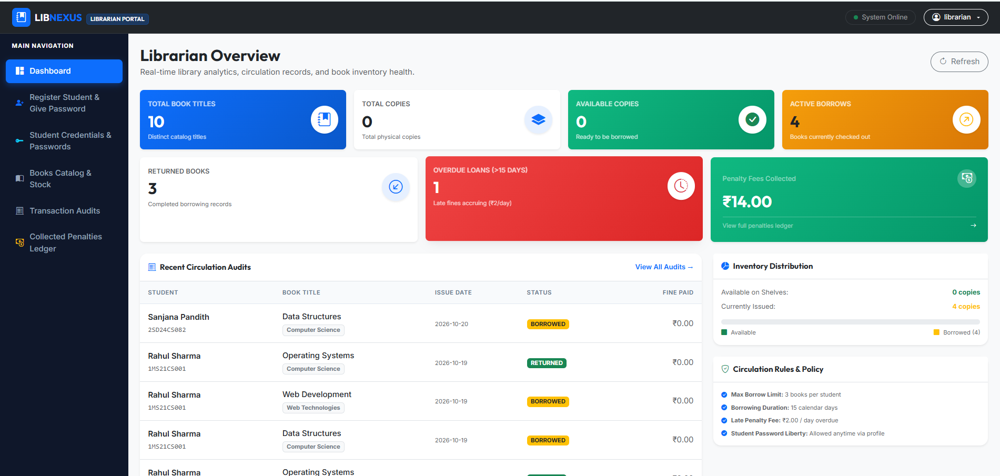

#### 2. Penalty Fees Collection Ledger
*Audit record of realized overdue fine revenue, transaction incident breakdowns, live filter tabs, and CSV ledger export.*
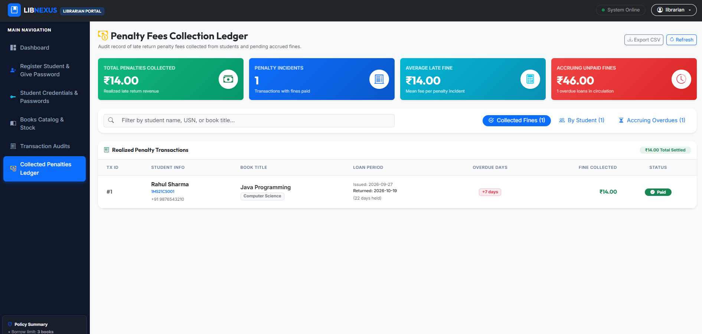

#### 3. Register Student & Account Creation
*Instant student enrollment, auto-generated secure passwords, credential clipboard copy, and comprehensive student account policy reference.*
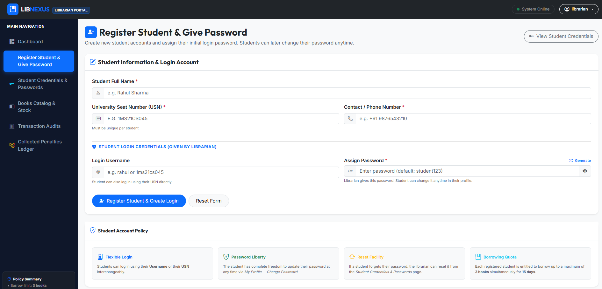

#### 4. Student Credentials & Passwords Registry
*Librarian master directory of student usernames, USNs, and one-click password reset facility.*
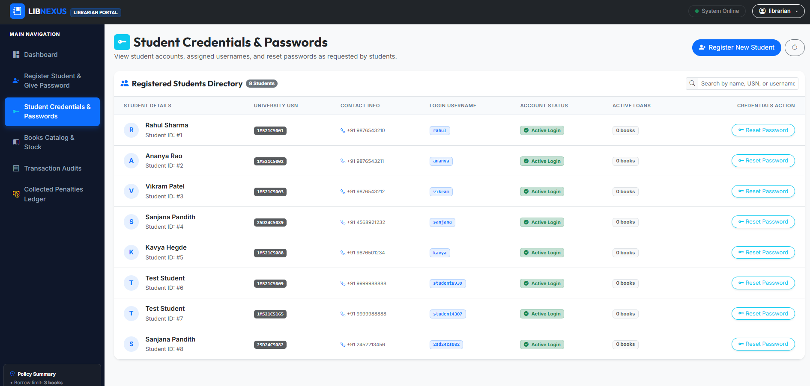

#### 5. Books Catalog & Inventory Stock Control
*Searchable book collection, stock status badges (In Stock, Low Stock, Out of Stock), and book creation/edit modals.*
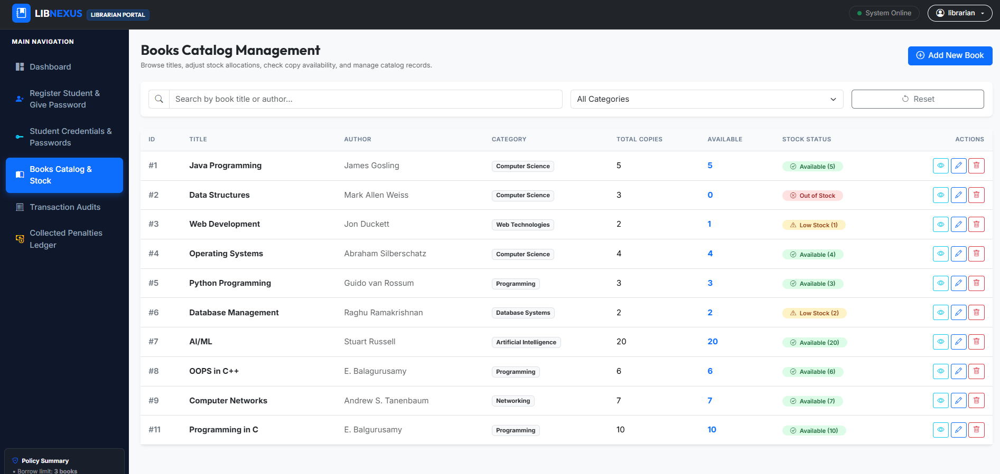

#### 6. Circulation Transaction Audits
*Complete chronological audit log of all book issues, returns, active loans, and settled late fees.*
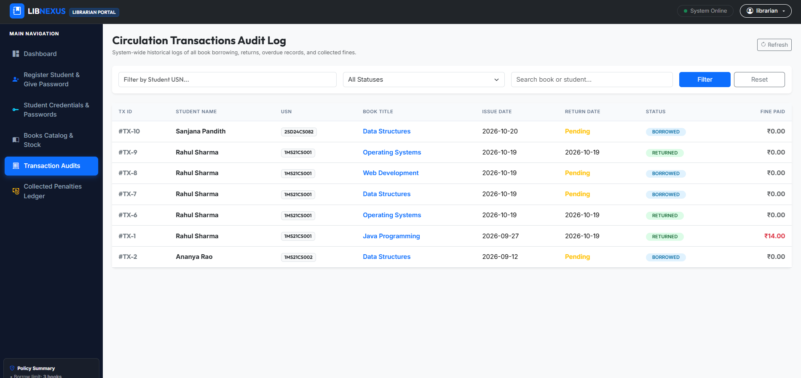

---

### 🎓 Student Self-Service Portal

#### 1. Student Overview & Quota Dashboard
*Personal borrowing quota counter (3-book limit), active loans summary, and quick access navigation cards.*
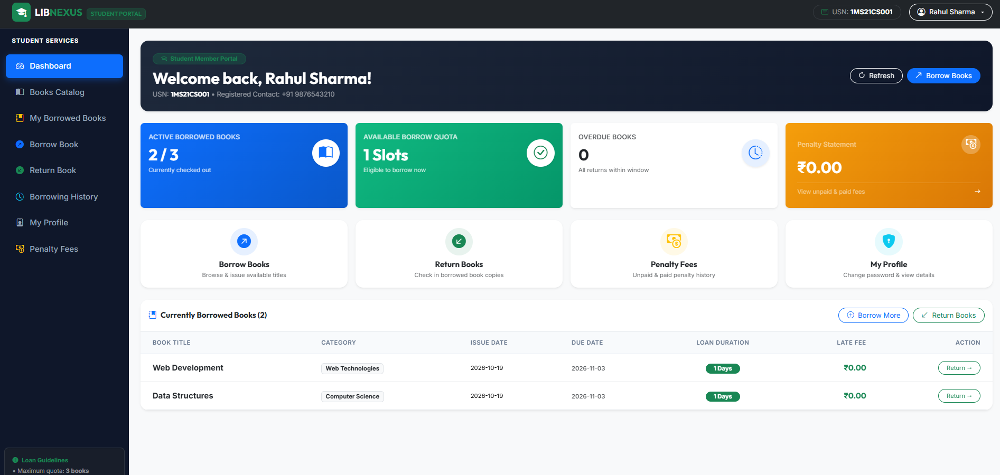

#### 2. Browse Catalog & Instant Book Borrowing
*Interactive book catalog displaying real-time availability with single-click book issue.*
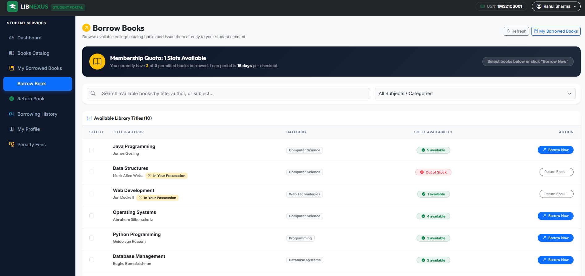

#### 3. My Borrowed Books & Due Date Countdown
*Active loan monitoring with loan duration countdowns, live overdue fine accrued counters, and return check-in.*
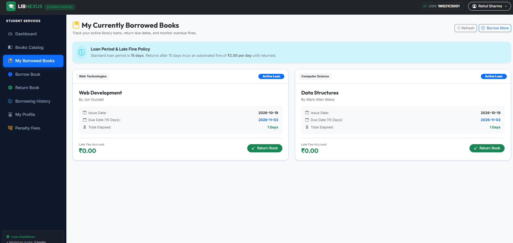

#### 4. Penalty Fees & Transaction History
*Transparent breakdown of paid and accruing late return fees with full borrowing history logs.*
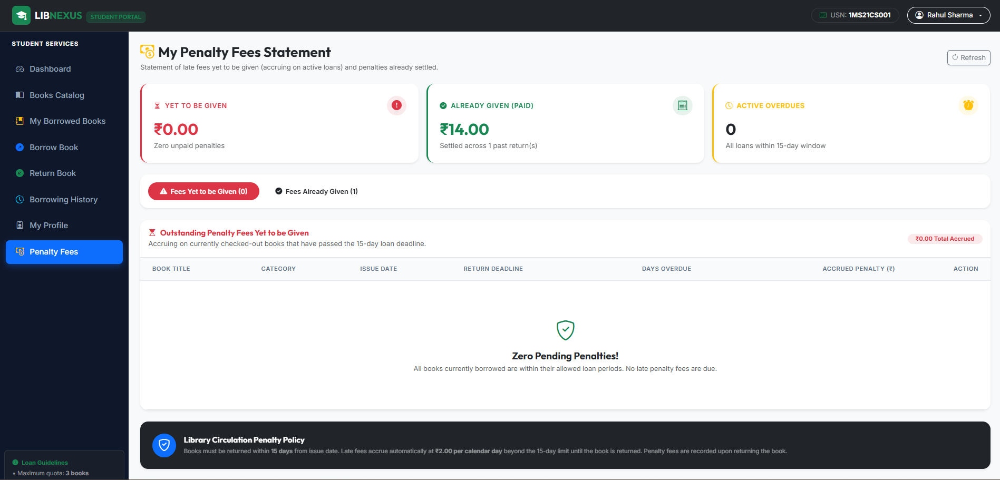

---

### 🔐 Authentication & Access Control

#### Split-Screen Sign In & Student Self-Registration
*Stateless JWT login with role detection, new student self-registration modal, and instant one-click demo credentials.*
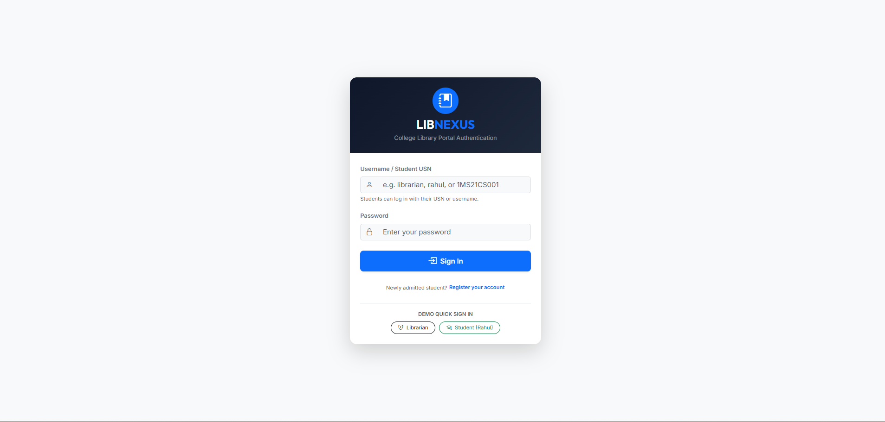

---

## Architecture Overview

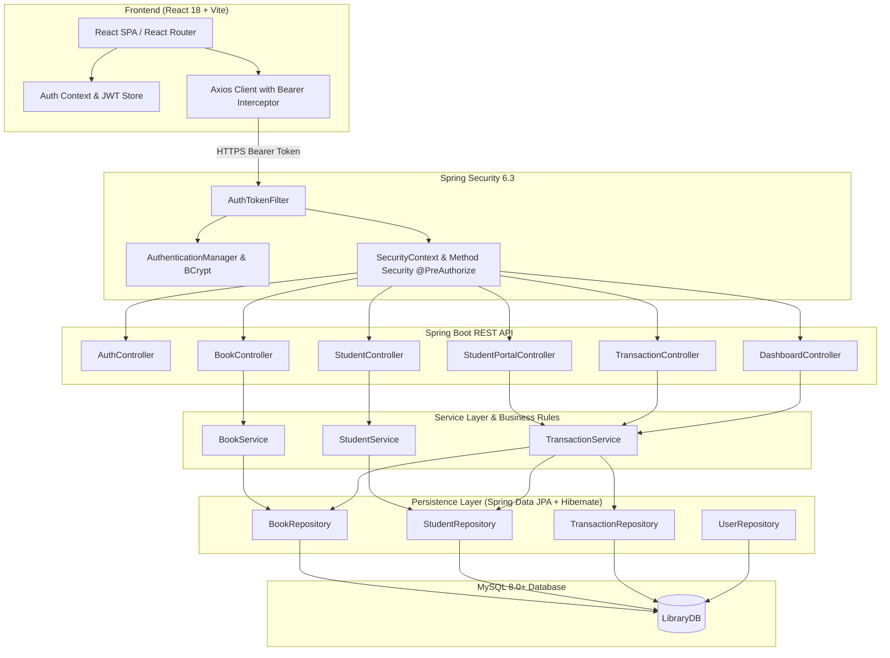

---

## Role-Based Access Control (RBAC)

The system enforces strict distinction between **Librarians** and **Students**:

| Capability / Module | Librarian (`ROLE_LIBRARIAN`) | Student (`ROLE_STUDENT`) | Unauthenticated |
|---|:---:|:---:|:---:|
| **Login / Authentication** | Full access | Full access | Allowed |
| **Client SPA Assets** | Full access | Full access | Allowed |
| **Catalog Browsing & Search** | Full access | Full access | Forbidden |
| **Book Inventory CRUD** | Create, Update, Delete | Read-Only | Forbidden |
| **Student Directory CRUD** | Create, Update, Delete | Forbidden (403) | Forbidden |
| **Circulation Issue / Borrow** | Full access | Forbidden (403) | Forbidden |
| **Circulation Return & Settle** | Full access | Forbidden (403) | Forbidden |
| **Audit Logs & All Transactions** | Full access | Forbidden (403) | Forbidden |
| **System Dashboard & Analytics** | Full access | Forbidden (403) | Forbidden |
| **Personal Student Portal** | Forbidden (403) | Personal Data Only | Forbidden |
| **Student Isolation Guarantee** | Access any USN | Isolated to Own USN | Forbidden |

### Student Data Privacy Guarantee
- Students can **only** inspect their own active checkouts, return history, and profile.
- Access to `/api/transactions/student/{usn}` strictly validates that the requesting token's authenticated student USN matches the targeted USN (`@PreAuthorize("hasRole('LIBRARIAN') or (hasRole('STUDENT') and principal.usn == #usn)")`).
- Any attempt by a student to request another student's record triggers a `403 Forbidden` JSON error response.

---

## Core Business Rules

1. **Borrowing Quota**: A student cannot borrow more than **3 books** concurrently.
2. **Duplicate Check**: A student cannot borrow a second copy of an unreturned book they currently hold.
3. **Atomic Stock & Inventory Integrity**:
   - Books can only be issued if `availableCopies > 0`.
   - Inventory is protected with JPA optimistic locking (`@Version private Long version;`) on `Book` entity to prevent race conditions during concurrent checkouts.
4. **Loan Term & Automated Fine Calculation**:
   - Standard borrowing term: **15 days**.
   - Overdue fine rate: **₹2.00 per day** past due date:
     $$\text{Fine} = (\text{Days Borrowed} - 15) \times ₹2.00$$

---

## Technology Stack

### Backend
- **Java 17+** (tested and compatible up to OpenJDK 24)
- **Spring Boot 3.3.3**
- **Spring Security 6.3** (stateless JWT authentication with BCrypt hashing)
- **JJWT 0.12.6** (`jjwt-api`, `jjwt-impl`, `jjwt-jackson`)
- **Spring Data JPA & Hibernate 6.5**
- **MySQL 8.0+**
- **Maven 3.8+**

### Frontend
- **React 18.3**
- **Vite 6.0** (fast modern bundling, HMR, proxy configuration)
- **React Router DOM 6** (client-side routing and protected routes)
- **Bootstrap 5.3.3 & Bootstrap Icons 1.11**
- **Axios 1.7** (HTTP client with request interceptors for Bearer token injection and response interceptors for 401 handling)

---

## Project Structure

```text
Library-Management-System/
├── frontend/                               # React + Vite Single-Page Application
│   ├── src/
│   │   ├── components/                     # Reusable UI widgets (StatCard, StockBadge, Modals)
│   │   ├── context/                        # AuthContext (JWT session state, login/logout)
│   │   ├── layouts/                        # Role-specific layouts (LibrarianLayout, StudentLayout)
│   │   ├── pages/                          # Application pages
│   │   │   ├── Login.jsx                   # Modern sign-in with instant demo credentials
│   │   │   ├── librarian/                  # Dashboard, Books, Students, Borrow, Return, Transactions
│   │   │   └── student/                    # Dashboard, Books Catalog, MyBooks, History, Profile
│   │   ├── routes/                         # ProtectedRoute component (RBAC guard)
│   │   ├── services/                       # Axios instance with interceptors (api.js)
│   │   ├── App.jsx                         # Main Router configuration
│   │   ├── index.css                       # Modern custom design system tokens & styles
│   │   └── main.jsx                        # React root entry
│   ├── package.json
│   └── vite.config.js                      # Configured to build directly into Spring Boot static resources
├── src/
│   ├── main/
│   │   ├── java/com/librarymanagement/
│   │   │   ├── config/
│   │   │   │   └── DataInitializer.java    # Seeds demo books, students, and BCrypt accounts
│   │   │   ├── controller/
│   │   │   │   ├── AuthController.java     # /api/auth/login and /api/auth/me
│   │   │   │   ├── BookController.java     # Book catalog CRUD & availability
│   │   │   │   ├── DashboardController.java# Aggregate metrics & KPIs
│   │   │   │   ├── SpaController.java      # HTML5 history forwarding to /index.html
│   │   │   │   ├── StudentController.java  # Student registry management
│   │   │   │   ├── StudentPortalController.java # Student self-service endpoints
│   │   │   │   └── TransactionController.java   # Borrow, return, and audit logs
│   │   │   ├── dto/                        # Request and Response transfer objects
│   │   │   ├── entity/                     # JPA Entities (Book, Student, Transaction, User, Role)
│   │   │   ├── exception/                  # GlobalExceptionHandler, Custom exceptions
│   │   │   ├── repository/                 # Spring Data JPA Repositories
│   │   │   ├── security/                   # Spring Security, JWT utilities, filters, and handlers
│   │   │   └── service/                    # Transactional business logic
│   │   └── resources/
│   │       ├── application.properties      # Database & JWT properties (with env var overrides)
│   │       └── static/                     # Compiled React SPA production bundle
│   └── test/
│       ├── java/com/librarymanagement/
│       │   ├── controller/AuthControllerTest.java
│       │   ├── security/SecurityAccessTest.java
│       │   └── service/
│       │       ├── BookServiceTest.java
│       │       └── TransactionServiceTest.java
│       └── resources/mockito-extensions/
├── pom.xml                                 # Maven dependencies and surefire configuration
└── README.md
```

---

## Database Configuration

Configure your database connection in `src/main/resources/application.properties`:

```properties
server.port=8080

spring.datasource.url=jdbc:mysql://localhost:3306/LibraryDB?useSSL=false&allowPublicKeyRetrieval=true&serverTimezone=UTC
spring.datasource.username=${DB_USERNAME:root}
spring.datasource.password=${DB_PASSWORD:password}
spring.datasource.driver-class-name=com.mysql.cj.jdbc.Driver

spring.jpa.hibernate.ddl-auto=update
spring.jpa.show-sql=false
spring.jpa.open-in-view=false

# JWT Secret & Expiration (24 hours)
app.jwt.secret=${JWT_SECRET:404E635266556A586E3272357538782F413F4428472B4B6250645367566B5970}
app.jwt.expiration-ms=${JWT_EXPIRATION_MS:86400000}
```

> **Note**: Database schema updates are handled automatically with `hibernate.ddl-auto=update`. Existing catalog and loan data are preserved.

---

## REST API Specification

### 1. Authentication (`/api/auth`)

| Method | Endpoint | Description | Auth Required |
|---|---|---|:---:|
| `POST` | `/api/auth/login` | Authenticate with username and password, returns JWT and user role | None |
| `GET` | `/api/auth/me` | Fetch profile and USN of currently authenticated token | Any Authenticated |

#### Sample Login Request
```json
POST /api/auth/login
Content-Type: application/json

{
  "username": "librarian",
  "password": "librarian123"
}
```

#### Sample Login Response
```json
{
  "token": "eyJhbGciOiJIUzI1NiJ9...",
  "type": "Bearer",
  "id": 1,
  "username": "librarian",
  "role": "ROLE_LIBRARIAN",
  "studentId": null,
  "studentName": null,
  "studentUsn": null
}
```

---

### 2. Student Portal (`/api/student-portal`)

Strictly accessible by authenticated students (`ROLE_STUDENT`):

| Method | Endpoint | Description |
|---|---|---|
| `GET` | `/api/student-portal/dashboard` | Returns student summary, active book count, remaining quota, and fine alerts |
| `GET` | `/api/student-portal/my-books` | Returns currently borrowed books with due dates and live accrued fines |
| `GET` | `/api/student-portal/history` | Returns historical returned loans and settled fines |
| `GET` | `/api/student-portal/profile` | Returns student identity, registered USN, and contact info |

---

### 3. Book Management (`/api/books`)

| Method | Endpoint | Description | Access Control |
|---|---|---|:---:|
| `GET` | `/api/books` | List books (supports `search` and `category` filters) | Librarian & Student |
| `GET` | `/api/books/{id}` | Get book details by ID | Librarian & Student |
| `GET` | `/api/books/{id}/availability` | Check current inventory and availability | Librarian & Student |
| `POST` | `/api/books` | Add a new book to the catalog | Librarian Only |
| `PUT` | `/api/books/{id}` | Update existing book information | Librarian Only |
| `DELETE` | `/api/books/{id}` | Remove a book from the catalog | Librarian Only |

---

### 4. Student Registry (`/api/students`)

| Method | Endpoint | Description | Access Control |
|---|---|---|:---:|
| `GET` | `/api/students` | List all registered students (supports `search` filter) | Librarian Only |
| `GET` | `/api/students/{id}` | Get student by ID | Librarian Only |
| `GET` | `/api/students/usn/{usn}` | Get student by USN | Librarian Only |
| `POST` | `/api/students` | Register a new student | Librarian Only |
| `PUT` | `/api/students/{id}` | Update student contact information | Librarian Only |
| `DELETE` | `/api/students/{id}` | Remove student record | Librarian Only |

---

### 5. Circulation & Transactions (`/api/transactions`)

| Method | Endpoint | Description | Access Control |
|---|---|---|:---:|
| `POST` | `/api/transactions/borrow` | Issue books to a student by USN and Book ID(s) | Librarian Only |
| `POST` | `/api/transactions/return` | Process return by transaction ID or USN & Book ID | Librarian Only |
| `GET` | `/api/transactions` | Query circulation log (`status`, `usn`, `search`) | Librarian Only |
| `GET` | `/api/transactions/student/{usn}` | Retrieve circulation records for a specific USN | Librarian or Matching Student |

---

### 6. Analytics & Dashboard (`/api/dashboard`)

| Method | Endpoint | Description | Access Control |
|---|---|---|:---:|
| `GET` | `/api/dashboard/stats` | System aggregate metrics, circulation counts, and recent activity | Librarian Only |

---

## Seeded Test Accounts

The application automatically seeds demonstration accounts upon first run in `DataInitializer`:

| Role | Username | Password | Linked USN | Description |
|---|---|---|---|---|
| **Librarian** | `librarian` | `librarian123` | *N/A* | Head Librarian with complete administrative privileges |
| **Student** | `rahul` | `student123` | `1MS21CS001` | Student with active loan (overdue demo loan with fine) |
| **Student** | `ananya` | `student123` | `1MS21CS002` | Student with active loan within due date |
| **Student** | `vikram` | `student123` | `1MS21CS003` | Student with clean loan history |

---

## Getting Started

### Prerequisites
- **Java Development Kit (JDK)**: Version 17 or higher
- **Node.js**: Version 18 or higher & `npm`
- **MySQL Server**: Version 8.0 or higher
- **Apache Maven**: Version 3.8 or higher

### 1. Database Setup
Ensure your MySQL server is running, and create the database:
```sql
CREATE DATABASE IF NOT EXISTS LibraryDB;
```

### 2. Run in Development Mode

#### Terminal 1 — Start Backend Server:
```bash
# In project root:
mvn spring-boot:run
```
The backend starts at `http://localhost:8080`.

#### Terminal 2 — Start Frontend React Server:
```bash
# In frontend directory:
cd frontend
npm install
npm run dev
```
The Vite development server will start at `http://localhost:5173`. API calls are automatically proxied to `http://localhost:8080`.

---

### 3. Run in Production Mode (Single-JAR Deployment)

The frontend is configured to build directly into Spring Boot's `src/main/resources/static` directory. This allows running the entire application as a single self-contained executable jar:

```bash
# 1. Build the React frontend production bundle:
cd frontend
npm run build
cd ..

# 2. Package and run the Spring Boot application:
mvn clean package -DskipTests
java -jar target/library-management-system-0.0.1-SNAPSHOT.jar
```
Now access the full application directly at:
```text
http://localhost:8080
```

---

## Automated Test Suite

The project includes unit and integration tests covering business rules, optimistic concurrency, and Spring Security authorization:

```bash
mvn test
```

### Test Coverage Highlights:
- **`TransactionServiceTest`**: Validates borrowing quota (3-book limit), duplicate unreturned loan rejection, stock decrement, 15-day return processing, and overdue fine calculations.
- **`BookServiceTest`**: Validates book creation, duplicate title constraints, availability checking, and stock status categorization.
- **`AuthControllerTest`**: Validates JWT authentication and invalid credential rejections.
- **`SecurityAccessTest`**: Verifies role-based endpoint protection (students blocked from librarian routes, student data isolation across USNs, and public SPA routing).